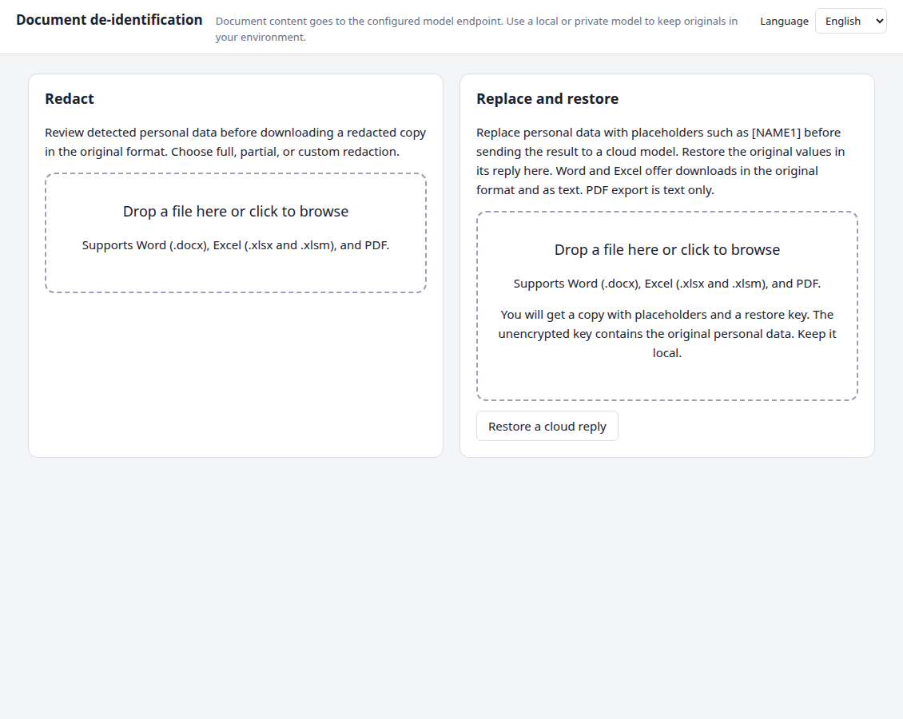
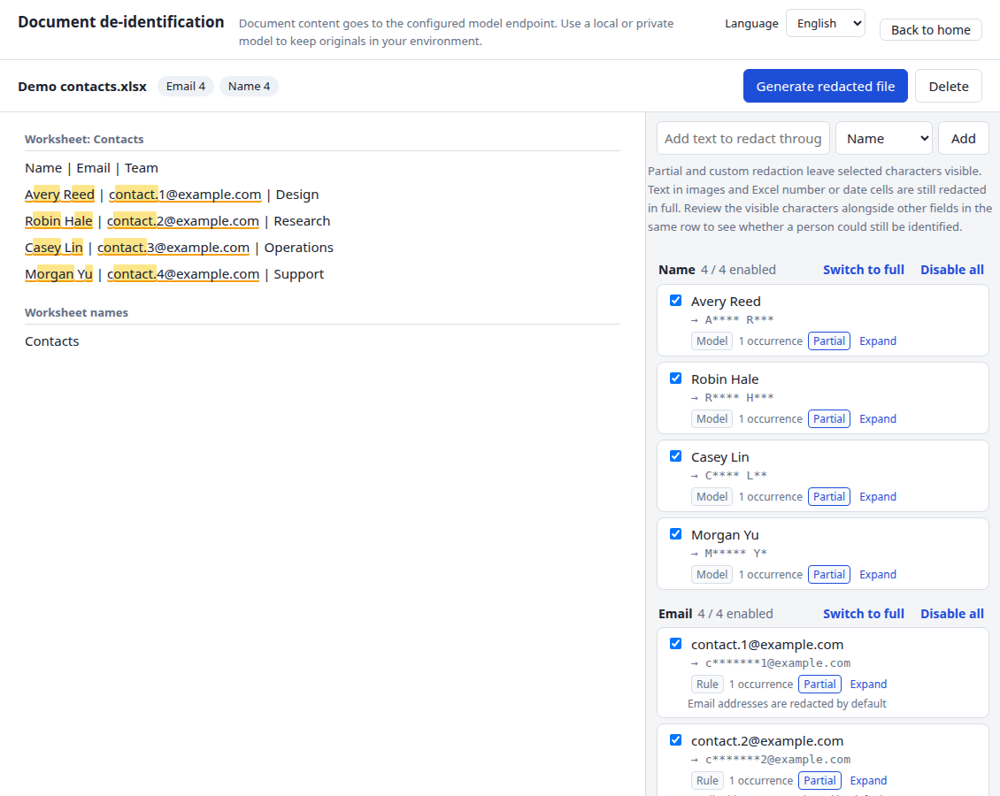
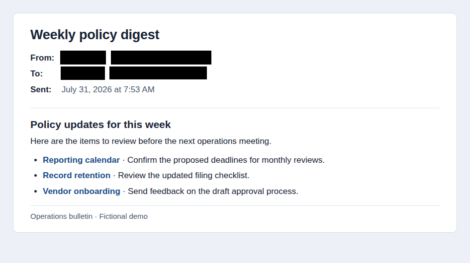
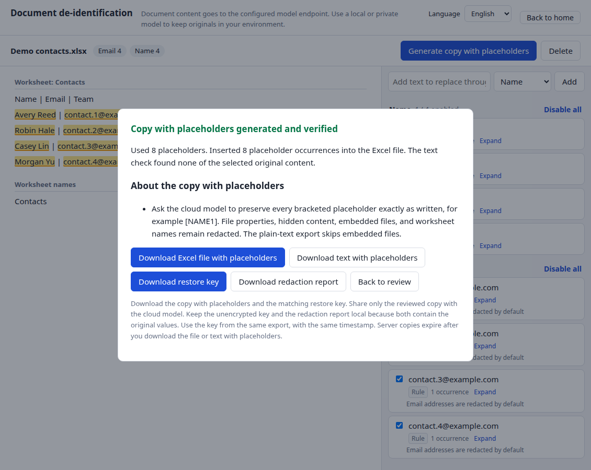
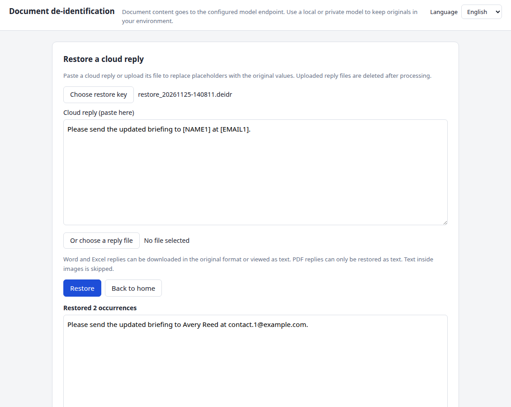

# VeilSpan

Self-hosted, agentic redaction and reversible masking for Traditional Chinese documents.

English · [繁體中文](README.md)

VeilSpan finds sensitive information in Word, Excel, and PDF files. Review the findings before exporting, choose how much to redact, or replace selected values with placeholders for a cloud model and restore them locally afterward.



## Agentic detection

The model uses tools to decide what to inspect next. It can read text in context, search for alternate spellings of a name, inspect images, and flag uncertain findings. VeilSpan tracks which parts were reviewed and runs standard detection over unchecked parts if the agent stops early. Rules cover common identifiers such as email addresses and checksum-validated IDs.

Contextual detection quality and processing time depend on the model you choose. Look for reliable tool calling and strong Traditional Chinese comprehension. Image input enables model-assisted image review. After you approve the findings, VeilSpan applies the selected redactions or placeholders and checks the generated output for remaining matches.

## Why I built it

I started with Presidio. In my setup, legitimate street names, model numbers, and organization names were often redacted from Taiwanese documents. I built VeilSpan so I could use document context to review findings and keep the original file format when sharing the result.

## Redact a document

Upload a file, review the findings, and choose **full**, **partial**, or **custom** redaction for individual values. You can add missed text or select a region of an image or PDF page. The redacted download keeps the file format.

The review screen shows what will stay visible. In this example, partial redaction preserves the first and last characters before the `@` and the domain of each email address.



VeilSpan can also redact text or selected regions inside embedded images. This fictional English email shows how it covers the sender’s and recipient’s names and email addresses while leaving the message readable.



## Use placeholders and restore a cloud reply

1. Choose **Placeholders + restore**, upload a file, and review the findings. Download the copy with placeholders and the `.deidr` restore key from the same export.
2. Share the reviewed copy with your cloud model. Keep the restore key local. It contains the original values in plaintext. The optional redaction report also contains original values.
3. Paste the model’s reply or upload its file in VeilSpan and select the matching restore key. VeilSpan fills in the original values while retaining the other changes in the reply.

> Keep bracketed placeholders such as `[NAME1]`, `[NAME1b]`, and `[EMAIL1]` exactly as written.





The language selector changes the interface and new placeholder exports. English uses codes such as `[NAME1]` and `[EMAIL1]`. Traditional Chinese uses `[姓名1]` and `[電子郵件1]`. Restore uses the codes stored in the original export’s key in either interface language.

## Formats and limits

| Input | Redacted download | Placeholders and restore |
| --- | --- | --- |
| Word (`.docx`) | Word | Word or plain text |
| Excel (`.xlsx`, `.xlsm`) | Excel | Excel or plain text |
| PDF, including scanned pages for redaction | PDF | Plain text |

VeilSpan is designed for Traditional Chinese and Taiwanese identifiers. It also handles examples such as English names and email addresses. Phone, identity number, and partial redaction rules are primarily tailored to Taiwan.

Some fields, such as Word ChartEx charts, Excel chart print headers, and PDF form field names and tooltips, are outside the current detection coverage and may be skipped without a warning. In Word and Excel placeholder files, images and some hidden content are redacted permanently. PDF replies with image-only content need to be pasted as text. Review the findings and output before sharing. [Detailed usage and limits (Traditional Chinese)](docs/usage.md)

## Run locally

Use Linux with Python 3.12 and an OpenAI-compatible Chat Completions endpoint. Setup downloads the OCR and face detection models.

```bash
./scripts/setup.sh
```

Set `LLM_BASE_URL`, `LLM_MODEL`, and, if required, `LLM_API_KEY` in the generated `.env` file. The example binds the web service to loopback.

```bash
./run.sh
```

Open `http://127.0.0.1:8620/?lang=en`. For Docker, run `./scripts/docker-up.sh` after setting up `.env`. This option uses the host Docker socket to start read-only document inspection containers.

### Choose where detection runs

The detection endpoint can be a local model, an internal server, or a compatible cloud API. VeilSpan sends original document content to the configured endpoint during detection. To keep originals in your environment, use a local or internal endpoint for detection and send the reviewed placeholder copy to a cloud model for the follow-up task.

### Extend the web app for a team

`LLM_CONCURRENCY` limits simultaneous model requests per process. The default web app queues document analysis on one worker and uses an IP allowlist for access. For a team deployment, add sign-in or SSO, assign jobs to users, and check permissions for review, downloads, and deletion. To analyze multiple documents at once, extend the job queue to coordinate multiple workers and isolate each user’s files. [Example settings](.env.example) · [Web API](deid/web/app.py) · [Job queue](deid/jobs.py)

## Test and contribute

```bash
DEID_SKIP_LIVE=1 .venv/bin/python -m pytest
```

The suite covers file parsing, redaction, placeholder export, restore, and the web API. Docker and browser tests use a local sandbox image and Chromium where available.

I welcome reproducible reports of false positives, missed findings, and layout issues, especially for Traditional Chinese documents. Please use fictional examples and include what you expected to be redacted or retained.

## License

[AGPL-3.0-only](LICENSE). [Third-party notices](THIRD_PARTY_NOTICES.md) cover dependencies and the OCR and face detection models.
