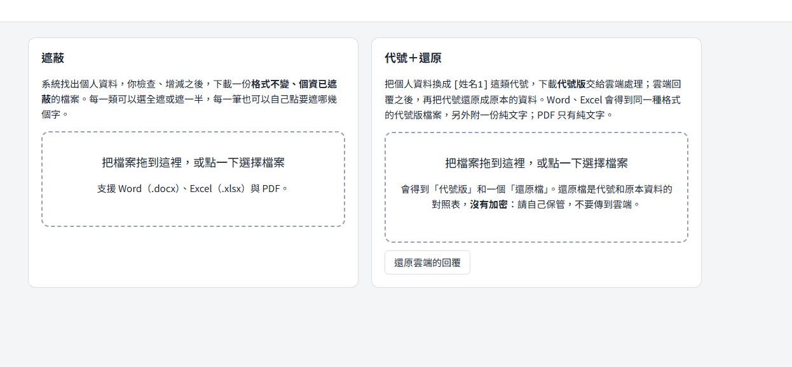
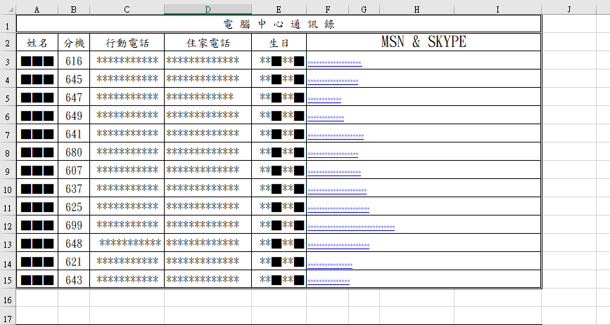
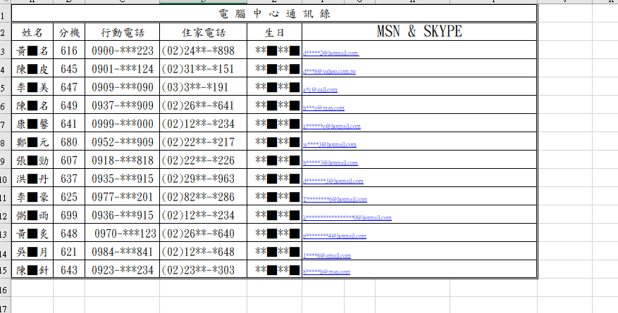
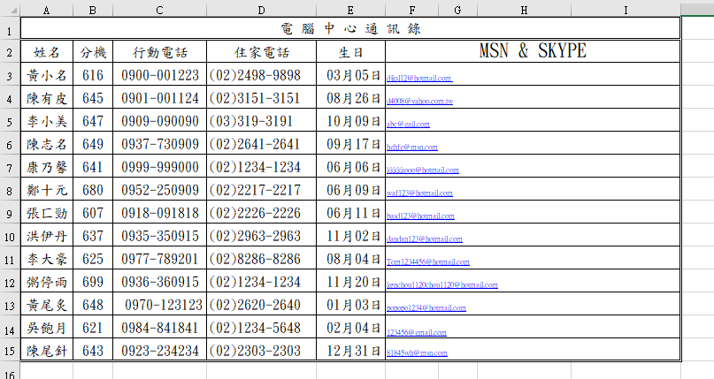
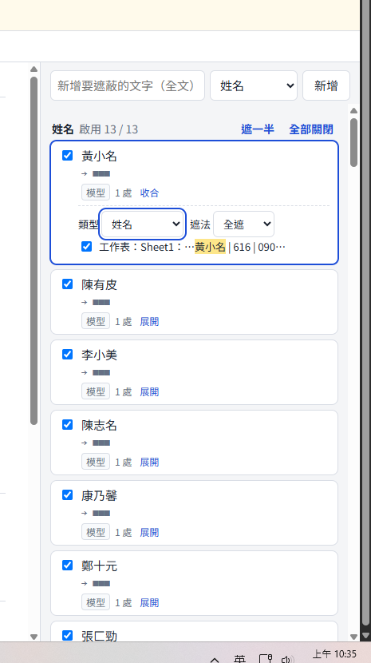
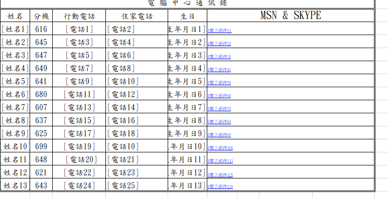
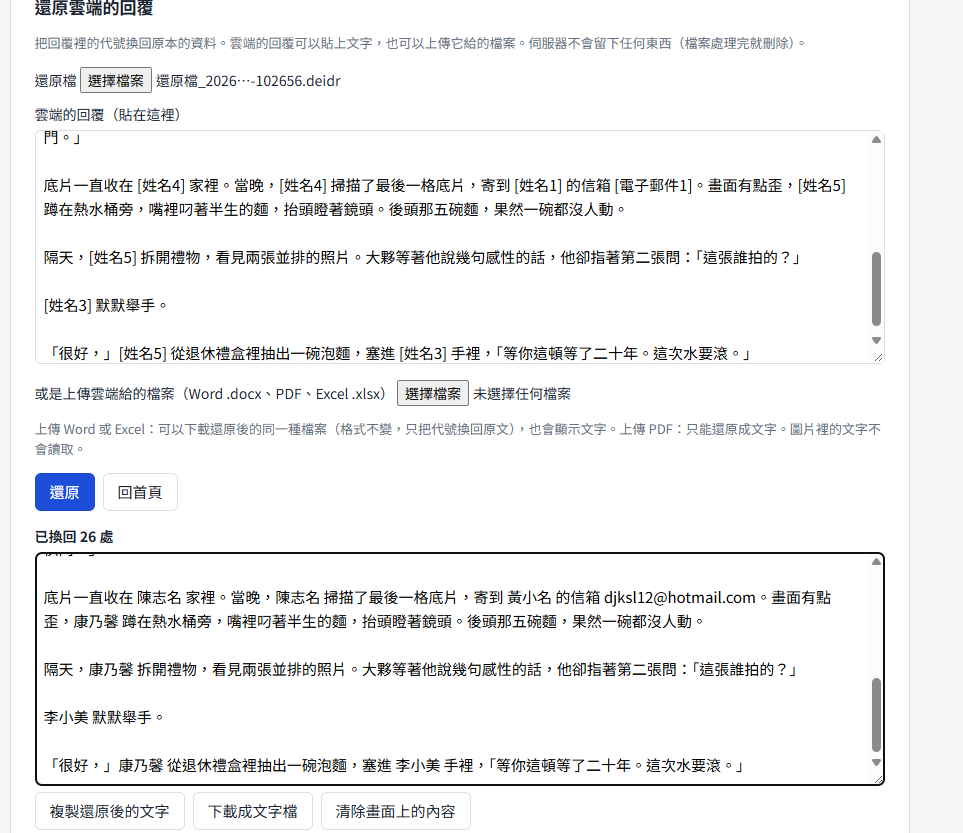
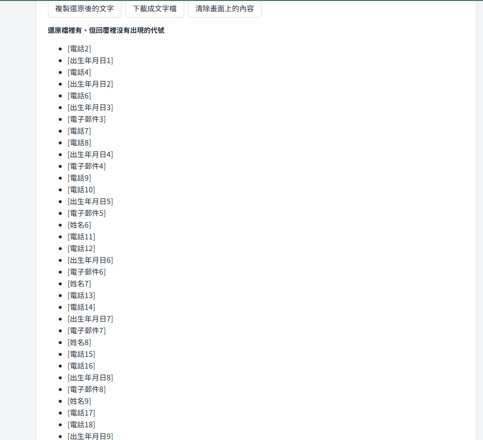

# VeilSpan 文件去識別化

繁體中文 · [English](README.en.md)

**遮完一份文件，還得把誤遮的型號和機關名稱一筆筆改回來？**

VeilSpan 是為台灣繁中文件設計的自架 Web App。上傳 Word、Excel 或 PDF，逐筆複核偵測結果，選擇全遮、半遮或自訂，再下載同格式的檔案。

想用雲端 AI 處理文件時，可先用本機或內網模型偵測，把個資換成 `[姓名1]` 之類的代號。拿到 Word 或 Excel 回覆後，用同批還原檔把代號換回原文，保留 AI 修改的內容。



## Agentic 偵測怎麼運作

模型會透過工具決定下一步要查什麼，例如讀取前後文、搜尋姓名變體、查看圖片，或標記疑似誤判。VeilSpan 會追蹤哪些部分已檢查。代理提早停止時，未檢查的部分會交由標準流程補查。電子郵件和可驗證檢查碼的證號等常見格式也有規則保底。

上下文判斷的品質和處理時間會受所選模型影響。建議選擇繁中理解及工具呼叫能力穩定的模型。支援圖片輸入的模型也可協助判斷圖片。使用者確認要處理的位置後，VeilSpan 依選取結果遮蔽或寫入代號，並檢查輸出是否仍有殘留。

## 兩種用法

| 功能 | 流程 |
|---|---|
| **文件遮蔽** | 檢查偵測結果，選擇全遮、半遮或自訂，再下載同格式的檔案。適合對外分享和交付。 |
| **代號化＋還原** | 在自架環境把個資換成 `[姓名1]` 之類的代號，將代號版交給雲端模型。處理完後，用同一批產生的還原檔在本地把代號換回原文，保留雲端修改過的內容。 |

請只將複核後的代號版交給雲端。還原檔含未加密的原文對照，請留在本地。交給雲端時，可以加上這句：

> 請逐字保留所有方括號代號，例如 `[姓名1]`、`[姓名1b]` 和 `[電話1]`。

| 格式 | 遮蔽輸出 | 代號化與還原 |
|---|---|---|
| Word（`.docx`） | Word | Word 或文字 |
| Excel（`.xlsx`、`.xlsm`） | Excel | Excel 或文字 |
| PDF（含掃描件） | PDF | 文字 |

右上角可切換繁體中文與 English。產生代號版時會使用所選語言，例如繁中 `[姓名1]`、`[電子郵件1]`，英文 `[NAME1]`、`[EMAIL1]`。使用與代號版同一次產生的還原檔，即可在任一介面語言還原。英文姓名和 Email 也能處理，電話、證號與部分遮蔽規則以台灣格式為主。

## 操作示例

### 文件遮蔽

下圖是同一份虛構 Excel 通訊錄的全遮與半遮輸出，供對照遮蔽範圍。

#### 全遮

選定的姓名、電話、生日與電子郵件都已遮蔽。表格版面與原先未選取的欄位仍可閱讀。



#### 半遮

姓名和電話保留部分字元。這份範例中的信箱保留 `@` 前的首尾字元與網域，其餘字元以星號遮蔽。



<details>
<summary>查看原始範本與遮法設定</summary>

**原始範本**



**編輯遮法**



</details>

#### 圖片遮蔽

文件內的圖片也能遮蔽。下圖是郵件截圖的遮蔽結果，寄件者與收件者資訊已用黑框蓋住。


### 代號化＋還原

將選定的個資換成 `[姓名1]`、`[電子郵件1]` 等代號，下載維持原格式的代號版和同一批還原檔。



複核後只把代號版交給雲端處理。拿到回覆後，選取本地保存的還原檔，即可把回覆裡的代號換回原文。



<details>
<summary>查看未出現在回覆中的代號</summary>

還原後可核對哪些代號沒有出現在雲端回覆中。



</details>

## 為什麼做

我原本用 Presidio 處理繁中文件。在我當時的配置和文件上，個資大多抓得到，但路名、型號和機關名稱也常被遮掉，交付前得逐筆改回來。我因此做了一套把文件上下文、人工審閱和原格式輸出接在一起的工具。

## 快速開始

需要 Linux、Python 3.12，以及可連線的 OpenAI 相容 Chat Completions 端點。安裝會下載 OCR 和人臉偵測模型。

```bash
./scripts/setup.sh
```

編輯安裝時建立的 `.env`，依你的模型服務填入 `LLM_BASE_URL`、`LLM_MODEL` 和需要的 `LLM_API_KEY`。設定範例預設只允許這台電腦連線。

```bash
./run.sh
```

瀏覽器開啟 `http://127.0.0.1:8620`。如需用 Docker 部署，執行 `./scripts/docker-up.sh`。Docker 會掛載主機的 Docker socket，以啟動隔離的文件檢查容器。

### 選擇偵測模型的部署位置

偵測可接本機模型、內網服務或相容的雲端 API。偵測時原始文件內容會送到所設定的模型端點。如果原文要留在自己的環境，將偵測端點設在本機或內網，後續再把人工複核過的代號版送給雲端模型處理。

### 擴充為團隊使用的 Web App

`LLM_CONCURRENCY` 可調整單一程序同時送出的模型請求數。現有 Web App 使用 IP 白名單，文件分析由一個 worker 依序處理。要部署給多人使用，可接上登入或 SSO，為每份工作指定擁有者，並檢查審閱、下載及刪除的權限。若需要同時處理多份文件，則可擴充工作佇列來協調多個 worker，並隔離各使用者的檔案。 [範例設定](.env.example) · [Web API](deid/web/app.py) · [工作佇列](deid/jobs.py)

## 文件、測試與參與

- [使用手冊](docs/usage.md)包含遮法、代號與還原、支援範圍、已知限制和 CLI。
- [第三方授權](THIRD_PARTY_NOTICES.md)列出 Python 套件、模型及容器使用的元件。
- 在安裝後執行 `DEID_SKIP_LIVE=1 .venv/bin/python -m pytest`，即可跑本機測試。Docker 測試需要可使用的隔離映像。

歡迎分享可以重現的繁中誤遮、漏遮或版面案例，也歡迎交流模型設定。提交範例時請用自行建立的虛構文件。如果能同時寫出「哪些字應該遮、哪些應該留下」，就能一起把案例做成回歸測試。

## 授權

VeilSpan 程式碼採 [GNU Affero General Public License v3.0 only（AGPL-3.0-only）](LICENSE)。
