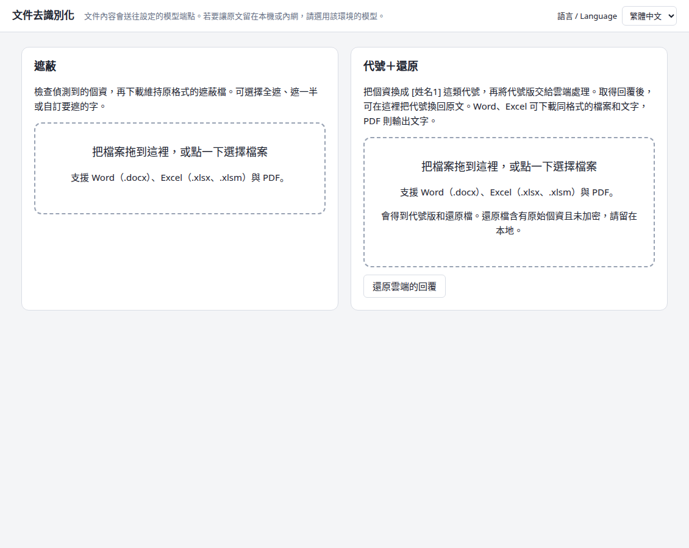
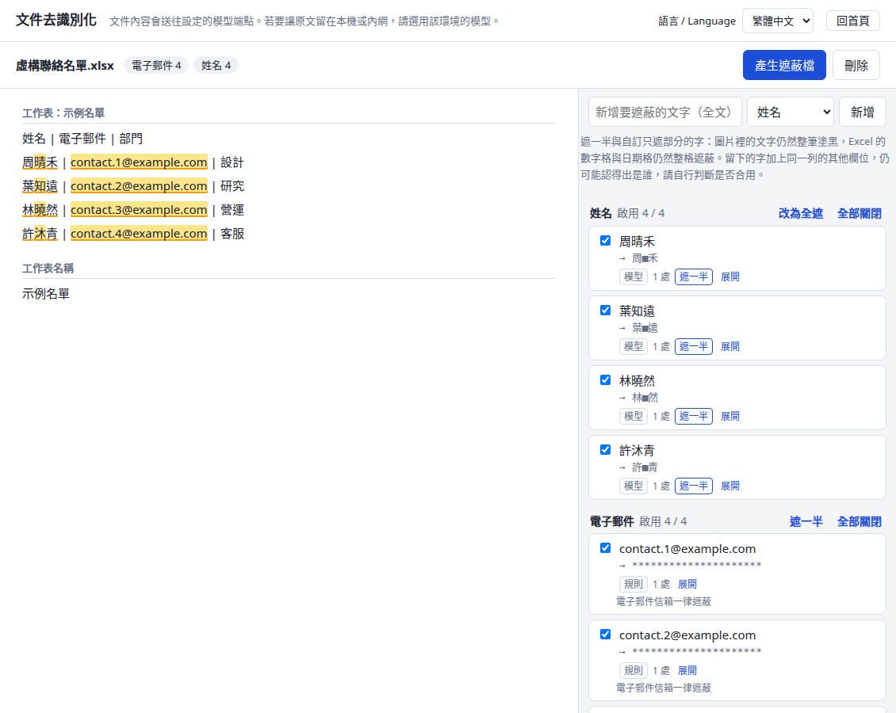
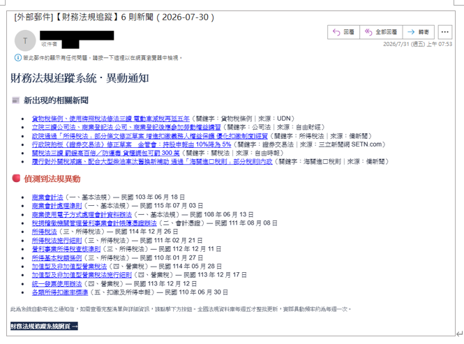
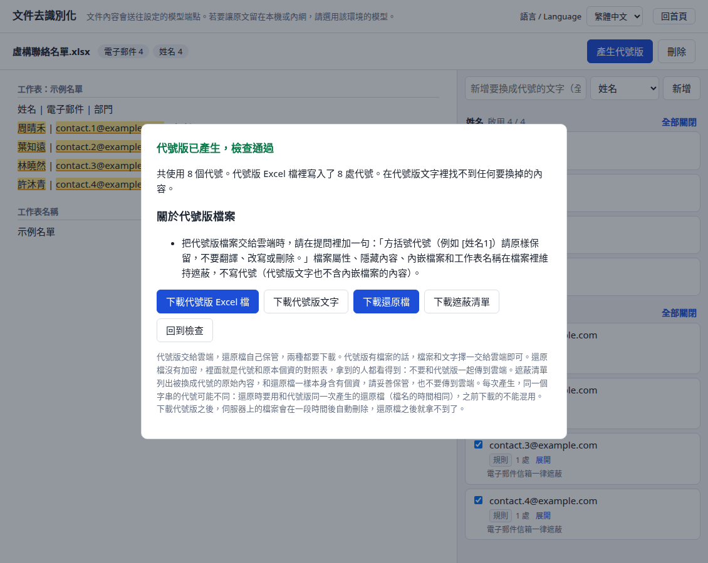
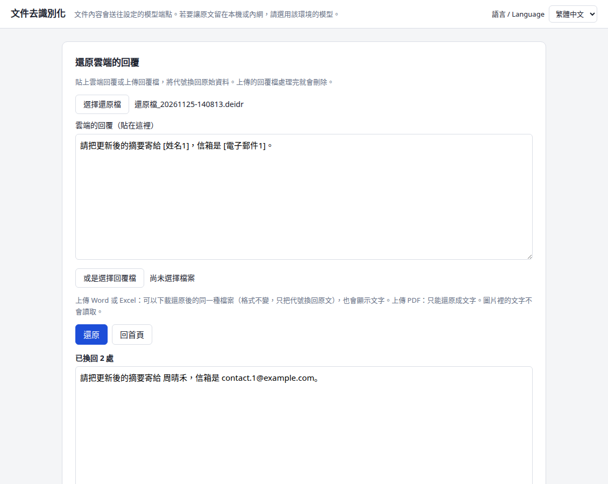

# VeilSpan 文件去識別化

Self-hosted redaction and reversible masking for Traditional Chinese documents.

[English](README.md) · 繁體中文

為繁體中文與台灣文件設計的自架工具。上傳 Word、Excel 或 PDF，逐筆確認個資，再下載遮蔽檔，或將原文轉成代號交給雲端模型處理。



## 兩種用法

| 功能 | 流程 |
|---|---|
| **文件遮蔽** | 檢查偵測結果，選擇全遮、半遮或自訂，再下載同格式的檔案。適合對外分享和交付。 |
| **代號化＋還原** | 在自架環境把個資換成 `[姓名1]` 之類的代號，將代號版交給雲端模型。處理完後，用同一批產生的還原檔在本地把代號換回原文，保留雲端修改過的內容。 |

請只將複核後的代號版交給雲端。還原檔含未加密的原文對照，請留在本地。交給雲端時，可以加上這句：

> 請逐字保留所有方括號代號，例如 `[姓名1]`、`[姓名1b]` 和 `[電話1]`。

| 格式 | 遮蔽輸出 | 代號化與還原 |
|---|---|---|
| Word（`.docx`） | Word | Word 或文字 |
| Excel（`.xlsx`、`.xlsm`） | Excel | Excel 或文字 |
| PDF（含掃描件） | PDF | 文字 |

右上角可切換繁體中文與 English。產生代號版時會使用所選語言，例如繁中 `[姓名1]`、`[電子郵件1]`，英文 `[NAME1]`、`[EMAIL1]`。使用與代號版同一次產生的還原檔，即可在任一介面語言還原。英文姓名和 Email 也能處理，電話、證號與部分遮蔽規則以台灣格式為主。

## 操作示例

### 文件遮蔽

以虛構的 Excel 通訊錄為例。可逐筆核對姓名與電子郵件，再對不同欄位選擇全遮、半遮或自訂。



文件內的圖片也能遮蔽。下圖是郵件截圖的遮蔽結果，寄件者與收件者資訊已用黑框蓋住。



### 代號化＋還原

將選定的個資換成 `[姓名1]`、`[電子郵件1]` 等代號，下載維持原格式的代號版和同一批還原檔。



複核後只把代號版交給雲端處理。拿到回覆後，選取本地保存的還原檔，即可把回覆裡的代號換回原文。



## 為什麼做

我原本用 Presidio 處理繁中文件。在我當時的配置和文件上，個資大多抓得到，但路名、型號和機關名稱也常被遮掉，交付前得逐筆改回來。我因此做了一套把文件上下文、人工審閱和原格式輸出接在一起的工具。

代理可以查看文件結構、搜尋姓名的其他寫法、檢查圖片與候選項，也能標記疑似誤判。由使用者確認要遮的位置，再由程式改檔並檢查輸出是否還留有選定要遮蔽的內容。

## 快速開始

需要 Linux、Python 3.12，以及可連線的 OpenAI 相容模型端點。模型若支援工具呼叫和圖片輸入，就能使用相應的代理與圖片判斷功能。安裝會下載 OCR 和人臉偵測模型。

```bash
./scripts/setup.sh
```

編輯安裝時建立的 `.env`，依你的模型服務填入 `LLM_BASE_URL`、`LLM_MODEL` 和需要的 `LLM_API_KEY`。設定範例預設只允許這台電腦連線。

```bash
./run.sh
```

瀏覽器開啟 `http://127.0.0.1:8620`。如需用 Docker 部署，執行 `./scripts/docker-up.sh`。Docker 會掛載主機的 Docker socket，以啟動隔離的文件檢查容器。服務目前沒有登入機制，請部署在可信任的環境。

文件內容會送到 `.env` 所設定的模型端點。若要讓原始文件留在你的環境，請填入本機或內網模型端點。下載或把代號版交給雲端前，請複核偵測結果及介面列出的注意事項。

## 文件、測試與參與

- [使用手冊](docs/usage.md)包含遮法、代號與還原、支援範圍、已知限制和 CLI。
- [第三方授權](THIRD_PARTY_NOTICES.md)列出 Python 套件、模型及容器使用的元件。
- 在安裝後執行 `DEID_SKIP_LIVE=1 .venv/bin/python -m pytest`，即可跑本機測試。Docker 測試需要可使用的隔離映像。

歡迎分享可以重現的繁中誤遮、漏遮或版面案例，也歡迎交流模型設定。提交範例時請用自行建立的虛構文件。如果能同時寫出「哪些字應該遮、哪些應該留下」，就能一起把案例做成回歸測試。

## 授權

VeilSpan 程式碼採 [GNU Affero General Public License v3.0 only（AGPL-3.0-only）](LICENSE)。
